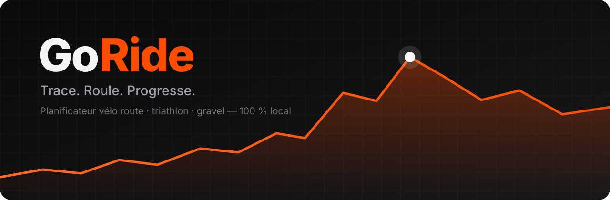

<div align="center">



### Le planificateur vélo qui pense comme une cycliste.

Des itinéraires qui restent sur le goudron, des boucles prêtes en une fraction de seconde,<br>
l'analyse complète de tes sorties et un coach IA — **gratuit, sans compte, et 100 % sur ton PC.**

<br>

[](https://github.com/MoreIIo/GoRide/releases/latest)

[](https://github.com/MoreIIo/GoRide/releases)
[](LICENSE)
[](https://www.rust-lang.org)
[](https://tauri.app)

[Fonctionnalités](#-fonctionnalités) · [Installation](#-installation) · [Guide de démarrage](#-guide-de-démarrage) · [FAQ](#-faq) · [Compiler](#%EF%B8%8F-compiler-depuis-les-sources)

</div>

---

## 🚴 Pourquoi GoRide ?

Tu as déjà suivi un itinéraire « vélo de route » qui t'envoie sur un chemin de terre au bout de 20 km ? Payé un abonnement juste pour générer une boucle ? Hésité à confier toutes tes données cardio à un serveur à l'autre bout du monde ?

**GoRide est né de ces frustrations.**

|  |  |
|---|---|
| 🛣️ **Goudron garanti** | Le profil Route ne passe *que* par des routes revêtues. Pas de surprise gravier. |
| ⚡ **Boucles instantanées** | Un clic, une distance : 5 boucles différentes en moins d'une seconde. |
| 📊 **Analyse de niveau pro** | Puissance normalisée, TSS, zones, forme / fatigue, records sur chaque montée. |
| 🧠 **Coach IA privé** | Un vrai modèle de langage qui tourne sur ta carte graphique. Rien ne quitte ton PC. |
| 🆓 **Gratuit, pour de vrai** | Pas de compte, pas d'abonnement, pas de pub. Code ouvert sous licence MIT. |

---

## ✨ Fonctionnalités

### 🗺️ Tracé d'itinéraires
- **Moteur de routage maison**, écrit en Rust à partir des données OpenStreetMap
- **Trois profils** :
  - **Route** : goudron uniquement, petites routes tranquilles préférées aux grands axes
  - **Triathlon** : goudron lisse, peu de carrefours, de ronds-points et de traversées de ville, pour rouler sans relance
  - **Gravel** : les chemins sont recherchés au lieu d'être évités
- **Réglages fins** : du plus plat possible jusqu'à la chasse aux bosses, évitement des grands axes, pistes cyclables, pente maximale (6 à 15 %)
- **Tracé à la souris** : les points se collent à la route, se déplacent en direct, s'insèrent n'importe où
- **Profil altimétrique** synchronisé avec la carte, D+ / D−, répartition des revêtements
- **Cartes Route, Topo et Satellite IGN**, relief et **vue 3D**
- **Export GPX** et **parcours Garmin FIT** prêts pour ton compteur

### 🔁 Boucles automatiques
- Choisis un départ, une distance et, si tu veux, une direction
- **5 propositions vraiment différentes**, avec peu d'allers-retours, en respectant tous tes réglages
- Compare-les sur la carte, garde ta préférée et modifie-la à la main
- Aucune ne te plaît ? « Autres propositions » relance un tirage sans reproposer ce que tu as déjà vu

### 📈 Analyse des sorties
- Import **FIT** (Garmin, Wahoo…), **GPX**, **TCX**, d'un dossier entier ou de **l'archive d'export Strava** (gratuite, même sans abonnement)
- **Puissance** : NP, IF, TSS, W/kg, meilleurs efforts de 5 s à 1 h
- **Cœur et cadence** : zones, dérive cardiaque, régularité
- **Montées détectées automatiquement**, avec pente, VAM et catégorie, et **comparées d'une sortie à l'autre** : ton record et ton classement sur chaque côte
- **Progression** : forme (CTL), fatigue (ATL) et fraîcheur (TSB) expliquées en clair, kilomètres par semaine, évolution de ta vitesse sur le plat
- **Conseils automatiques** pour rouler plus vite

### 🧠 Coach IA local
- Propulsé par [Ollama](https://ollama.com) : **le modèle tourne sur ton PC**, sans connexion à un service d'IA
- Il connaît ton profil, ta forme du jour et tes dernières sorties
- **Avis du coach** sur chaque sortie : ce qui va bien, ce qu'il faut travailler, la prochaine séance
- **Séances d'entraînement** sur mesure (« 1 h 15, travailler les côtes »), avec des cibles en watts ou en cardio, **exportables sur ton Garmin**
- **Il agit dans l'appli** : demande-lui « une boucle de 60 km vallonnée depuis Rennes » et il la trace sur la carte

---

## 📥 Installation

1. Va sur la page **[Releases](https://github.com/MoreIIo/GoRide/releases/latest)**.
2. Télécharge **`GoRide_x.y.z_x64-setup.exe`**.
3. Lance-le et suis l'installation.

> [!NOTE]
> GoRide n'est pas (encore) signé numériquement. Au premier lancement, Windows peut afficher **« Windows a protégé votre ordinateur »**. Clique sur **Informations complémentaires**, puis sur **Exécuter quand même**.

**Configuration requise**

| | Minimum | Conseillé |
|---|---|---|
| Système | Windows 10 / 11, 64 bits | Windows 11 |
| Disque | Quelques centaines de Mo par région | + ~5 Go pour le coach IA |
| Coach IA (facultatif) | — | Carte graphique avec 8 Go de mémoire vidéo |

> [!IMPORTANT]
> La couverture routière concerne actuellement la **France métropolitaine**.

---

## 🚀 Guide de démarrage

### 1. Tracer ton premier itinéraire
1. Lance GoRide et place-toi sur ta région. Au premier clic, **les routes de la région sont téléchargées automatiquement** (une seule fois, quelques minutes selon ta connexion).
2. Appuie sur **`T`** pour passer en mode tracé.
3. **Clique** sur la carte pour poser des points de passage : l'itinéraire se calcule tout seul entre eux.
4. **Glisse** un point pour le déplacer, **clic droit** pour le supprimer, **clic sur le tracé** pour insérer un point.
5. Ajuste le profil (Route, Triathlon, Gravel) et les curseurs dans le panneau en haut à droite : tout se recalcule en direct.

### 2. Générer une boucle
1. Clique sur **Boucle** (ou appuie sur **`B`**).
2. Clique sur ton point de départ et indique la distance voulue.
3. Compare les 5 propositions sur la carte, puis clique sur **Choisir**.

### 3. Envoyer le parcours sur ton compteur
- **Garmin** : exporte en **FIT**, branche ton compteur en USB et copie le fichier dans le dossier **`Garmin/NewFiles`**. Le parcours apparaît dans *Navigation → Parcours*.
- **Autres compteurs et applis** : exporte en **GPX** (`Ctrl+S`).

### 4. Importer tes sorties
Ouvre l'onglet **Sorties**, puis au choix :
- **glisse-dépose** des fichiers `.fit`, `.gpx` ou `.tcx` dans la fenêtre ;
- importe le dossier **`Garmin/Activity`** de ton compteur ;
- importe ton **archive Strava** : sur strava.com, va dans *Paramètres → Mon compte → Télécharger ou supprimer votre compte → Demander votre archive*. Tu reçois un lien par e-mail. Une fois l'archive décompressée, importe le dossier.

Les doublons sont ignorés automatiquement.

> [!TIP]
> Renseigne ta **FTP**, ta **FC max** et ton **poids** dans ton profil pour des zones et des conseils précis. Tu ne les connais pas ? GoRide reprend la FTP réglée sur ton compteur et te prévient quand tes sorties montrent qu'il est temps de les mettre à jour.

### 5. Activer le coach IA (facultatif)
1. Ouvre le menu **Coach**.
2. Suis l'installation guidée : d'abord **Ollama**, puis le modèle **`qwen3:8b`** (~5 Go, téléchargé une seule fois).
3. Discute avec ton coach, demande un avis sur une sortie ou une séance pour demain.

### ⌨️ Raccourcis clavier

| Touche | Action |
|---|---|
| `T` | Tracer un itinéraire |
| `B` | Générer une boucle |
| `Échap` | Arrêter le tracé |
| `Ctrl` + `Z` / `Ctrl` + `Y` | Annuler / rétablir |
| `Ctrl` + `S` | Exporter en GPX |

---

## 🔒 Confidentialité

**Tes données restent chez toi.** Tes sorties sont enregistrées dans une base locale, sur ton disque, et le coach IA tourne sur ta machine.

GoRide se connecte uniquement pour :
- afficher les fonds de carte (OpenFreeMap, OpenTopoMap, IGN) et le relief (Mapzen Terrain Tiles) ;
- rechercher une adresse (géocodage IGN) ;
- télécharger les données routières de ta région (Geofabrik / OpenStreetMap).

Aucun compte, aucun traceur, aucune statistique d'usage.

---

## ❓ FAQ

<details>
<summary><b>GoRide est-il vraiment gratuit ?</b></summary>

Oui. Pas d'abonnement, pas de version premium, pas de publicité. Le code est ouvert, sous licence MIT.
</details>

<details>
<summary><b>Faut-il un compte Strava ou Garmin ?</b></summary>

Non. GoRide lit directement les fichiers de ton compteur. Pour récupérer ton historique Strava, l'export d'archive gratuit suffit, sans abonnement.
</details>

<details>
<summary><b>Ça marche hors de France ?</b></summary>

Pas encore : le routage couvre la France métropolitaine. L'import et l'analyse des sorties fonctionnent partout.
</details>

<details>
<summary><b>Mon PC n'a pas de carte graphique puissante. Je peux utiliser GoRide ?</b></summary>

Oui. Seul le coach IA a besoin d'une bonne carte graphique. Tout le reste fonctionne sans, et les séances types restent disponibles sans IA.
</details>

<details>
<summary><b>Et sur Mac ou Linux ?</b></summary>

Seule la version Windows est publiée pour l'instant. GoRide repose sur Tauri, qui fonctionne aussi sur macOS et Linux : tu peux le compiler toi-même (voir ci-dessous).
</details>

---

## 🛠️ Compiler depuis les sources

<details>
<summary><b>Instructions pour les développeuses et développeurs</b></summary>

### Prérequis
1. **Rust** : <https://rustup.rs> (accepte l'installation des « Visual Studio C++ Build Tools »)
2. **Node.js LTS** : <https://nodejs.org>

### Le plus simple (Windows)
Double-clique sur **`build-exe.bat`**. Il installe les dépendances, compile et copie l'application et son installateur dans `release/`.

### En ligne de commande
```powershell
npm install          # la première fois seulement
npm run tauri dev    # lance GoRide en mode développement
npm run tauri build  # fabrique l'installateur → target/release/bundle/nsis/
```
La première compilation prend plusieurs minutes (~400 dépendances).

### Tests
```powershell
cargo test --workspace
# Bancs d'essai sur un vrai extrait OpenStreetMap (download.geofabrik.de)
cargo run --release -p goride-core --example bench_bretagne -- data/bretagne-latest.osm.pbf
cargo run --release -p goride-core --example bench_loops -- data/bretagne-latest.osm.pbf
```
Le dossier `data/` sert aux fichiers locaux (extraits OSM, sorties de test) et n'est pas versionné.

### Publier une version
Le workflow [`release.yml`](.github/workflows/release.yml) compile l'installateur sur GitHub et crée une release en brouillon à chaque tag `v*` :
```powershell
git tag v0.1.0
git push origin v0.1.0
```

### Architecture
```
crates/goride-core/   Cœur Rust sans interface (testé)
  osm_tags.rs           routes praticables, revêtement, sens
  graph/                construction, relief et stockage du réseau routier
  cost.rs               profils et réglages
  router.rs             accroche au réseau + meilleur chemin (A*)
  loops.rs              boucles automatiques
  activity/             lecture FIT / GPX / TCX, analyse, progression
  dem.rs                altitude (tuiles Terrarium, cache disque)
src-tauri/            Application Tauri : pont vers l'interface, bibliothèque, coach
src/                  Interface TypeScript + MapLibre : carte, tracé, sorties, coach
```
</details>

---

## 🙏 Crédits

- Données routières © [contributeurs OpenStreetMap](https://www.openstreetmap.org/copyright), extraits fournis par [Geofabrik](https://download.geofabrik.de)
- Fonds de carte : [OpenFreeMap](https://openfreemap.org), [OpenTopoMap](https://opentopomap.org) (CC-BY-SA), [IGN Géoplateforme](https://geoservices.ign.fr)
- Relief : [Mapzen Terrain Tiles](https://github.com/tilezen/joerd/blob/master/docs/attribution.md)
- Construit avec [Rust](https://www.rust-lang.org), [Tauri](https://tauri.app), [MapLibre GL JS](https://maplibre.org) et [Ollama](https://ollama.com)

## 📄 Licence

Distribué sous licence [MIT](LICENSE). © 2026 Maëlle Leynaud

<div align="center">
<br>
<b>Si GoRide t'accompagne sur la route, laisse une ⭐ au projet : ça fait toujours plaisir.</b>
<br><br>
<sub>Fait en Bretagne, avec des jambes qui piquent. 🚴‍♀️</sub>
</div>
